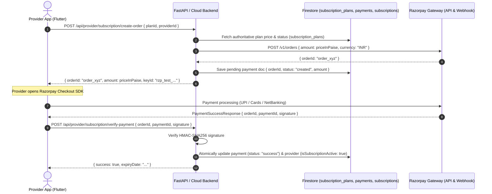

# JAMUI SERVICES — PAYMENT ARCHITECTURE DOCUMENTATION

## 1. Overview
This document describes the end-to-end payment architecture for provider subscriptions and services in APNA_JAMUI / Jamui Services.

## 2. Core Architectural Principles
1. **Never Trust the Client for Financial Data:** The Flutter application sends only `planId` and `providerId`. Amount calculation is 100% authoritative and executed exclusively on the server.
2. **Server-Side Order Creation:** Orders are generated via Razorpay API by the backend. The client cannot forge order IDs or modify prices.
3. **Cryptographic Verification:** Every completed transaction is verified using HMAC-SHA256 server-side before subscription benefits are granted.
4. **Zero Client-Side Secrets:** Only the public Razorpay Key ID (`RAZORPAY_KEY_ID`) is shared with clients. The `RAZORPAY_KEY_SECRET` and `RAZORPAY_WEBHOOK_SECRET` are never bundled in Flutter APKs or web builds.
